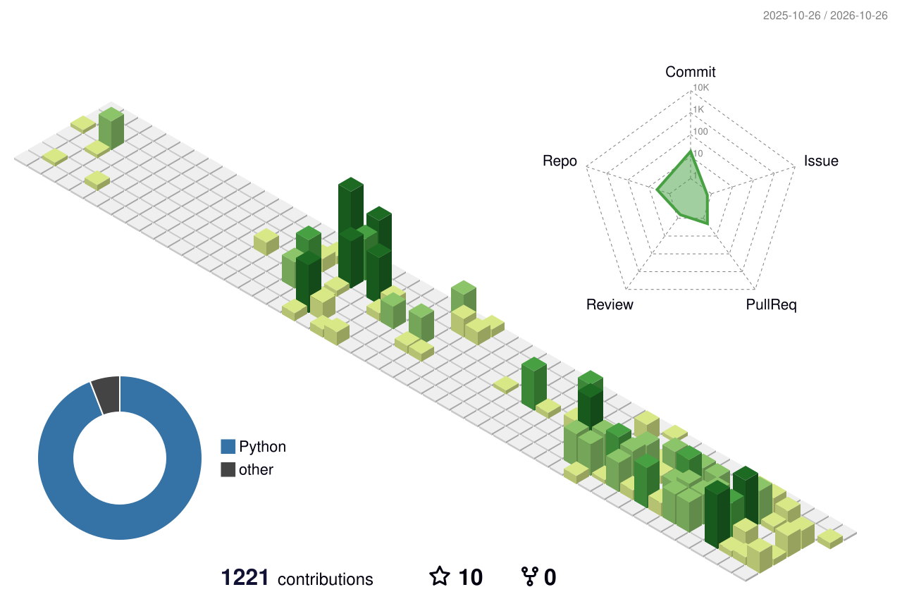

Oi! Sou desenvolvedor **full stack** (Python/React), com foco em **backend e IA aplicada**. Gosto de pegar uma ideia, provar que ela funciona e levar até alguém usar de verdade.

## 🚀 Construindo agora: [Anamnes.ia](https://anamnes-ia.vercel.app/)

Plataforma de treino de anamnese para estudantes de medicina, com **paciente simulado por IA**. Sou sócio e desenvolvedor.

- Começou como um script de terminal e virou uma plataforma web em React/TypeScript + FastAPI
- Uma turma de medicina usou a plataforma por 3 meses em atividade real
- Avaliação automática das entrevistas por LLM, com nota de 0 a 100 e feedback por categoria
- 444 testes automatizados e CI no GitHub Actions

## 📂 Projetos

<table>
  <tr>
    <td width="50%" valign="top">
      <a href="https://github.com/luizfsjunior/email-class"><b>📧 email-class</b></a> 
      Classifica e-mails em produtivo ou improdutivo com ML + LLM e sugere a resposta. 
      <code>Python</code> <code>OpenAI</code> <code>ML</code>
    </td>
    <td width="50%" valign="top">
      <a href="https://github.com/luizfsjunior/finance-backtest"><b>📈 finance-backtest</b></a> 
      Bancada de backtest para ações da B3, feita para <i>derrubar</i> teses, com custos e slippage. 
      <code>Python</code> <code>Dados</code>
    </td>
  </tr>
  <tr>
    <td width="50%" valign="top">
      <a href="https://github.com/luizfsjunior/cnpj-analytics"><b>🏢 cnpj-analytics</b></a> 
      API de analytics sobre os dados abertos de CNPJ da Receita: agregações, filtros e rede societária. 
      <code>Go</code> <code>PostgreSQL</code>
    </td>
    <td width="50%" valign="top">
      <a href="https://github.com/luizfsjunior/motor-pesquisa-preco"><b>🛒 motor-pesquisa-preco</b></a> 
      Monitora preços em marketplaces, guarda o histórico e avisa promoções pelo Telegram. 
      <code>Python</code> <code>Scraping</code> <code>Streamlit</code>
    </td>
  </tr>
</table>

## 🧰 Stack

  

## 📊 Atividade

<picture>
  <source media="(prefers-color-scheme: dark)" srcset="profile-3d-contrib/profile-night-rainbow.svg">
  
</picture>

## 📫 Contato

  

<picture>
  <source media="(prefers-color-scheme: dark)" srcset="https://raw.githubusercontent.com/luizfsjunior/luizfsjunior/output/snake-dark.svg">
  
</picture>
