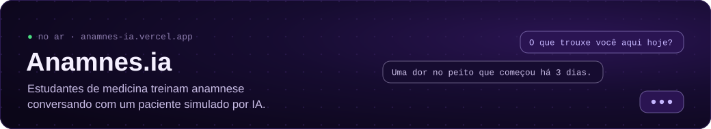

Mais puxado para backend e IA aplicada. Vim da eletrônica e me formei em Ciência da Computação na PUC Minas. Gosto de entender as coisas por dentro, do hardware ao LLM, e de desconfiar das minhas ideias até testar.

<table>
  <tr>
    <td width="50%" valign="top">
      <a href="https://github.com/luizfsjunior/email-class"><b>email-class</b></a> 
      Classifica e-mails em produtivo ou improdutivo com ML + LLM e sugere a resposta.
    </td>
    <td width="50%" valign="top">
      <a href="https://github.com/luizfsjunior/finance-backtest"><b>finance-backtest</b></a> 
      Bancada de backtest para ações da B3, feita para <i>derrubar</i> teses, com custos e slippage.
    </td>
  </tr>
  <tr>
    <td width="50%" valign="top">
      <a href="https://github.com/luizfsjunior/cnpj-analytics"><b>cnpj-analytics</b></a> 
      API em Go sobre os dados abertos de CNPJ da Receita: agregações, filtros e rede societária.
    </td>
    <td width="50%" valign="top">
      <a href="https://github.com/luizfsjunior/motor-pesquisa-preco"><b>motor-pesquisa-preco</b></a> 
      Monitora preços em marketplaces, guarda o histórico e avisa promoções pelo Telegram.
    </td>
  </tr>
</table>

  

  &nbsp;
  

<picture>
  <source media="(prefers-color-scheme: dark)" srcset="https://raw.githubusercontent.com/luizfsjunior/luizfsjunior/output/snake-dark.svg">
  
</picture>
